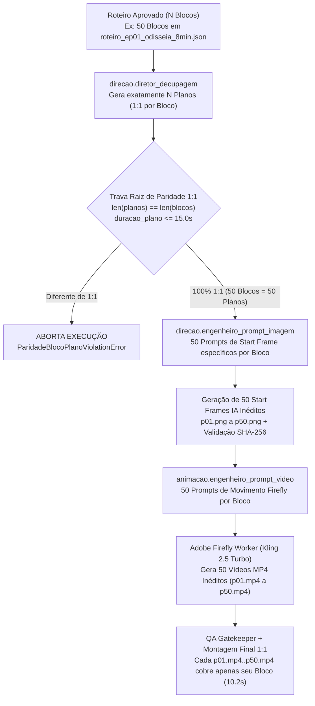

# Plano Geral e Passo a Passo: Paridade Estrita `1 Bloco = 1 Start Frame IA = 1 Vídeo Firefly` na Raiz (`d:\LUME`)

> [!CAUTION]
> **REGRA DE OURO NA RAIZ (PARIDADE 1:1 INEGOCIÁVEL):**
> **Cada bloco do roteiro DEVE gerar exatamente 1 imagem (Start Frame IA inédito) e 1 vídeo inédito renderizado no Adobe Firefly (`Kling 2.5 Turbo`).**
> É terminantemente proibido agrupar múltiplos blocos de narração dentro de uma mesma cena visual (como ocorreu em `roteiro_12_planos_firefly.json`, que comprimiu 50 blocos de narração em 12 cenas de ~42s) ou usar `diretor_decupagem_node` com números fixos de planos.

---

## 1. Diagnóstico da Causa Raiz (Por Que 50 Blocos Viraram 12 Cenas)

| Ponto de Falha na Raiz | Arquivo / Linha | O Que Aconteceu | Impacto no Vídeo Gerado |
| :--- | :--- | :--- | :--- |
| **1. `diretor_decupagem_node` com 5 planos fixos hardcoded** | [grafo/direcao/subgrafo.py](file:///d:/LUME/grafo/direcao/subgrafo.py#L24-L114) | O agente de decupagem ignorava a lista `state["roteiro"]["blocos"]` e devolvia 5 planos estáticos fixos (`ep01_c01_p01..p05`) ou apenas repassava `planos_existentes` sem checar se a quantidade de planos batia com a quantidade de blocos do roteiro. | O grafo aceitava qualquer JSON externo com menos cenas do que blocos narrados (ex: 12 cenas para 50 blocos). |
| **2. Compressão indevida de 50 blocos em 12 cenas (`roteiro_12_planos_firefly.json`)** | [roteiro_12_planos_firefly.json](file:///d:/LUME/storage_local/episodios/ep01_odisseia_firefly_novo/roteiro/roteiro_12_planos_firefly.json) | Os 50 blocos de `10.2s` do roteiro ([roteiro_ep01_odisseia_8min.json](file:///d:/LUME/storage_local/roteiro/roteiro_ep01_odisseia_8min.json)) foram agrupados em 12 capítulos longos de `40.8s` a `51.0s`. | Enquanto a voz narrava 4 a 5 cenas diferentes em sequência (ex: Cão Argos -> Penélope -> Arco de Odisseu -> Trono -> Contador), a tela ficava presa num único take do Firefly repetido em loop. |
| **3. Ausência de Trava de Paridade `1:1` (`len(planos) == len(blocos)`) no Contrato Raiz** | [contratos/integridade_assets.py](file:///d:/LUME/contratos/integridade_assets.py) | O validador verificava apenas se os arquivos existentes eram inéditos (SHA-256), mas não verificava se existia **1 Start Frame + 1 Vídeo Firefly para cada bloco do roteiro**. | O pipeline permitiu finalizar um episódio de 50 blocos tendo apenas 12 Start Frames e 12 vídeos Firefly. |
| **4. `conformar_take_firefly_para_capitulo` permitindo esticar 1 vídeo de 5s para 51s** | [orquestrador_episodio_puro_firefly.py](file:///d:/LUME/orquestrador_episodio_puro_firefly.py#L268-L327) | A função de conformação aceitava qualquer `duracao_alvo_s` (inclusive `41.3s` e `51.5s`), fazendo `loop=3` de um único clipe de 5s para cobrir vários blocos de voz. | Descompasso visual-narrativo e repetição do mesmo movimento na tela por quase 1 minuto. |

---

## 2. Arquitetura Alvo na Raiz (Fluxo `1:1` Blindado)

---

## 3. Divisão em Subetapas Completas (Passo a Passo de Implementação)

---

### SUBETAPA 1 — Trava de Contrato `1 Bloco = 1 Start Frame = 1 Vídeo Firefly` (`contratos/integridade_assets.py`)
**Objetivo:** Tornar impossível, no nível de contrato de dados, que um episódio tenha menos planos visuais, menos Start Frames ou menos vídeos Firefly do que o número total de blocos do roteiro.

#### Passo a Passo:
1. **Criar a exceção fatal `ParidadeBlocoPlanoViolationError` em [contratos/integridade_assets.py](file:///d:/LUME/contratos/integridade_assets.py):**
   - Disparada sempre que `len(planos) != len(blocos)` ou quando um plano tentar cobrir mais de 1 bloco de narração (`duracao_s > 15.0`).
2. **Implementar `validar_paridade_1_para_1_blocos_planos(blocos, planos, episodio_id)`:**
   - Verifica `len(blocos) > 0` e `len(planos) == len(blocos)`.
   - Verifica, para cada índice `i` (`0..N-1`), que:
     - O plano `i` corresponde ao `bloco_numero = i + 1` (`id = p01..p50`).
     - A janela de tempo `janela_s` do plano `i` é idêntica à janela `janela_s` do bloco `i` (ex: `10.2s` por bloco, proibindo capítulos agrupados de `40s–51s`).
     - O plano `i` preserva o `texto_narracao`, `cena_tipo`, `canto_verso` e `contador_perdas` do bloco `i`.
3. **Implementar `auditar_completude_1para1_episodio(episodio_id, total_blocos)`:**
   - Verifica fisicamente em `storage_local/episodios/<episodio_id>/start_frames/` que existem exatamente `total_blocos` arquivos PNG inéditos (`p01.png` .. `p{N:02d}.png`).
   - Verifica fisicamente em `storage_local/episodios/<episodio_id>/renders_firefly/` que existem exatamente `total_blocos` arquivos MP4 inéditos (`p01.mp4` .. `p{N:02d}.mp4`), todos registrados com SHA-256 único no `asset_registry.db`.
4. **Expurgar o arquivo agrupado `roteiro_12_planos_firefly.json`:**
   - Remover a decupagem antiga de 12 cenas para que nunca mais seja usada.

- **Critério de Aceite da Subetapa 1:** Tentar validar um roteiro de 50 blocos com uma lista de 12 planos levanta imediatamente `ParidadeBlocoPlanoViolationError`.

---

### SUBETAPA 2 — Reescrita do Agente `direcao.diretor_decupagem` para Geração `1:1` Dinâmica (`grafo/direcao/subgrafo.py`)
**Objetivo:** Corrigir na raiz o agente [`diretor_decupagem_node`](file:///d:/LUME/grafo/direcao/subgrafo.py#L24-L114) para que ele SEMPRE gere **1 plano visual para cada bloco do roteiro**, eliminando os 5 planos fixos hardcoded.

#### Passo a Passo:
1. **Refatorar [`diretor_decupagem_node`](file:///d:/LUME/grafo/direcao/subgrafo.py#L24-L114) em [grafo/direcao/subgrafo.py](file:///d:/LUME/grafo/direcao/subgrafo.py):**
   - Ler `blocos = state.get("roteiro", {}).get("blocos", [])`.
   - Para cada bloco `b` (`1..N`), instanciar exatamente **1 objeto `Plano`** (`p01` a `p{N:02d}`):
     - Mapear `mundo = "contador"` quando `cena_tipo` contiver `"contador"`, e `mundo = "parede"` nos demais blocos.
     - Mapear automaticamente o `tipo_plano` do vocabulário fechado (`contador`, `escala`, `close`, `medio`, `insert`, `friso`) de acordo com o `cena_tipo` do bloco.
     - Definir `duracao_s` exatamente igual à duração do bloco (`janela_s[1] - janela_s[0]`, ex: `10.2s`).
     - Anexar `texto_narracao`, `cena_tipo`, `canto_verso`, `contador_perdas` e `janela_s` diretamente no plano.
   - Se `planos_existentes` for passado no estado com quantidade diferente de `len(blocos)` (exceto nos testes unitários sintéticos de 1–5 blocos sem roteiro de 50 blocos), recalcular ou validar a paridade `1:1`.
2. **Integrar com [`engenheiro_prompt_imagem_node`](file:///d:/LUME/grafo/direcao/engenheiro_prompt_imagem.py) e [`engenheiro_prompt_video_node`](file:///d:/LUME/grafo/animacao/engenheiro_prompt_video.py):**
   - Garantir que cada um dos `N` planos receba um prompt de imagem IA e um prompt de animação Firefly derivado especificamente da cena narrada naquele bloco (`texto_narracao` + `cena_tipo`), sem prompts genéricos repetidos.

- **Critério de Aceite da Subetapa 2:** Ao passar os 50 blocos de [roteiro_ep01_odisseia_8min.json](file:///d:/LUME/storage_local/roteiro/roteiro_ep01_odisseia_8min.json) pelo `direcao.diretor_decupagem`, a saída `state["decupagem"]["planos"]` contém exatamente **50 planos individuais (`p01` a `p50`)**, cada um com `10.2s` e vinculado ao seu bloco.

---

### SUBETAPA 3 — Catálogo Canônico dos 50 Blocos = 50 Prompts de Start Frame + 50 Prompts de Vídeo Firefly
**Objetivo:** Construir a especificação visual e de movimento `1:1` para todos os **50 blocos** do episódio de `08:30` ([roteiro_ep01_odisseia_8min.json](file:///d:/LUME/storage_local/roteiro/roteiro_ep01_odisseia_8min.json)), garantindo que nenhuma frase narrada fique sem sua cena visual correspondente.

#### Passo a Passo:
1. **Gerar o arquivo canônico `d:\LUME\storage_local\roteiro\roteiro_50_planos_firefly_1para1.json` (e espelhar na pasta do episódio):**
   - Mapear individualmente cada um dos **50 blocos (`p01` a `p50`)**:
     - **Prólogo (`p01` a `p04`):** `p01` Contador e o braseiro -> `p02` Embarque dos 600 nos 12 navios -> `p03` Guerreiros deixando filhos e famílias -> `p04` Contador revelando a sentença de morte no mar.
     - **Ato I (`p05` a `p10`):** `p05` Saque e vinho em Ísmaro (Cícones) -> `p06` Flor de Lótus na costa dos Lotófagos -> `p07` Marinheiros amarrados sob os bancos de remo -> `p08` Entrada na gruta de Polifemo com queijos e cabritos -> `p09` Polifemo fechando a caverna com o rochedo colossal -> `p10` Sombra do Ciclope atacando os guerreiros na pedra.
     - **Ato II (`p11` a `p18`):** `p11` Odisseu segurando o punho da espada no escuro -> `p12` Afiando o tronco de oliveira na brasa -> `p13` Oferta da taça de vinho negro de Maron -> `p14` Polifemo bebendo três taças -> `p15` O enigma do nome "Ninguém" -> `p16` Quatro homens cravando a estaca em brasa -> `p17` Polifemo cego gritando na entrada da caverna -> `p18` Odisseu na proa gritando seu nome e Polifemo invocando Poseidon.
     - **Ato III (`p19` a `p24`):** `p19` Éolo entregando o odre de couro com fio de prata -> `p20` Odisseu no leme por nove noites avistando a fumaça de Ítaca -> `p21` Marinheiros abrindo o saco dos ventos enquanto Odisseu dorme -> `p22` Onze navios entrando no fiorde estreito de Telépilo -> `p23` Gigantes Lestrigões esmagando os 11 navios do alto das falésias -> `p24` Odisseu cortando a amarra com a espada e fugindo com 1 único navio.
     - **Ato IV (`p25` a `p31`):** `p25` Banquete enfeitiçado no palácio de Circe (metamorfose) -> `p26` Odisseu com a flor sagrada Moly e a espada diante de Circe -> `p27` Navio singrando a névoa cinzenta rumo ao Hades -> `p28` Odisseu abrindo a vala ritual na terra fria (`cinza_alma`) -> `p29` Profecia do espectro cego de Tirésias -> `p30` Odisseu tentando abraçar três vezes a sombra da mãe Anticleia -> `p31` Colóquio com a sombra de Aquiles no Submundo.
     - **Ato V (`p32` a `p37`):** `p32` Mar liso como espelho diante da ilha das Sereias -> `p33` Sereias com corpo de ave de rapina sobre a praia de ossos -> `p34` Odisseu aquecendo a cera de abelha e selando os ouvidos dos remadores -> `p35` Odisseu sendo amarrado de pé ao mastro central -> `p36` Odisseu debatendo-se nas cordas diante do canto -> `p37` Euríloco e Perimedes apertando os nós e remando em silêncio.
     - **Ato VI (`p38` a `p44`):** `p38` O vórtice colossal de Caríbdis engolindo o mar -> `p39` As seis cabeças de Cila na caverna do penhasco -> `p40` O bote de Cila arrancando seis guerreiros do convés -> `p41` Tripulação faminta isolada pelos ventos na ilha de Trinácria -> `p42` Abate proibido do gado sagrado do Sol enquanto Odisseu dorme -> `p43` Céu negro de carvão e mar imóvel no Silêncio Dramático (`436.9s–438.4s`) -> `p44` O raio branco de Zeus partindo o mastro e destruindo o último navio.
     - **Ato VII & Epílogo (`p45` a `p50`):** `p45` Odisseu sozinho à deriva agarrado à quilha partida -> `p46` Odisseu tocando a areia de Ítaca vestido de mendigo 20 anos depois -> `p47` O velho cão Argos reconhecendo Odisseu na soleira e Penélope ao tear -> `p48` Odisseu envergando o grande arco do rei -> `p49` Odisseu no trono de pedra ao lado de Penélope -> `p50` O Contador diante da última brasa que se apaga (`"O lume apaga. A história fica."`).
2. **Higienização Preventiva de Prompts para o Filtro do Firefly (`generate-video-prompt-unsafe-error`):**
   - Garantir que todos os 50 `prompt_video` descrevam movimento cinematográfico, iluminação chiaroscuro, câmera e atmosfera sem palavras bloqueadas pelo filtro da Adobe.

- **Critério de Aceite da Subetapa 3:** Os 50 blocos possuem 50 prompts de imagem distintos e 50 prompts de vídeo distintos, cobrindo `0.0s` a `510.0s` em janelas exatas de `10.2s`.

---

### SUBETAPA 4 — Blindagem de QA, Animação e Montagem Final `1:1` (`grafo/animacao`, `grafo/qa`, `grafo/montagem`, `orquestrador_episodio_puro_firefly.py`)
**Objetivo:** Impedir que qualquer etapa de animação, QA ou montagem final aceite menos de 1 vídeo Firefly por bloco ou estique um vídeo de 5s por 40–50 segundos.

#### Passo a Passo:
1. **Atualizar [`conformar_take_firefly_para_capitulo`](file:///d:/LUME/orquestrador_episodio_puro_firefly.py#L268-L327) em [orquestrador_episodio_puro_firefly.py](file:///d:/LUME/orquestrador_episodio_puro_firefly.py):**
   - Bloquear qualquer `duracao_alvo_s > 15.0` com `ParidadeBlocoPlanoViolationError("Proibido esticar 1 take Firefly para múltiplos blocos")`.
   - Para cada bloco de `10.2s`, conformar o take nativo de `5.04s` do Firefly em `0.5x` (`setpts=2.0*PTS` = `10.08s` contínuos de movimento fluido em 24fps, cobrindo exatamente os `10.2s` do bloco sem repetir em loop 3x!).
2. **Atualizar [`qa_originalidade_node`](file:///d:/LUME/grafo/qa/subgrafo.py) e [`finalizador_node`](file:///d:/LUME/grafo/montagem/subgrafo.py):**
   - Exigir `validar_paridade_1_para_1_blocos_planos(blocos, planos, episodio_id)` antes de aprovar o Gate 3 ou iniciar o FFmpeg de montagem final.

- **Critério de Aceite da Subetapa 4:** Qualquer tentativa de montar um episódio onde `len(renders_firefly) != len(blocos)` ou onde um plano dure mais de `15s` aborta imediatamente.

---

### SUBETAPA 5 — Testes Automatizados da Regra `1 Bloco = 1 Start Frame = 1 Vídeo Firefly` e Execução Completa dos 50 Blocos
**Objetivo:** Validar com testes automatizados que a trava `1:1` está ativa na raiz e executar a geração dos Start Frames e vídeos Firefly para os **50 blocos** (`p01` a `p50`).

#### Passo a Passo:
1. **Adicionar testes em [test_politica_zero_reuso_raiz.py](file:///d:/LUME/test_politica_zero_reuso_raiz.py):**
   - **Teste 1:** `diretor_decupagem_node` recebe os 50 blocos de `roteiro_ep01_odisseia_8min.json` e retorna exatamente 50 planos (`p01..p50`).
   - **Teste 2:** `validar_paridade_1_para_1_blocos_planos` bloqueia imediatamente se passarmos 12 planos para um roteiro de 50 blocos (`ParidadeBlocoPlanoViolationError`).
   - **Teste 3:** `conformar_take_firefly_para_capitulo` bloqueia qualquer duração `> 15.0s`.
2. **Executar a Geração Completa 1:1 (`p01` a `p50`):**
   - Gerar os Start Frames IA inéditos (`p01.png` a `p50.png`) para cada um dos 50 blocos do roteiro.
   - Renderizar os 50 vídeos correspondentes no Adobe Firefly (`p01.mp4` a `p50.mp4`) e montar o Master Final `1:1` de `08:30` (`510.0s`), onde a imagem e o vídeo mudam exatamente a cada bloco (`10.2s`) em sincronia total com a narração.
