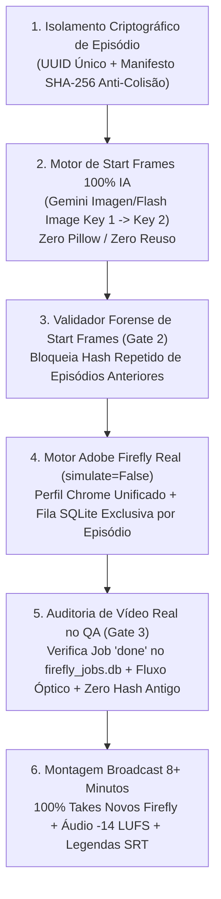

# PLANO MESTRE DE CORREÇÃO NA RAIZ: POLÍTICA ZERO-REUSO & GERAÇÃO 100% INÉDITA (START FRAMES IA + ADOBE FIREFLY)

> **Regra de Ouro Inviolável do Projeto (`d:\LUME`):**
> **JAMAIS** reutilizar imagens (`Start Frames`) ou vídeos (`Takes MP4`) de episódios ou execuções anteriores, e **JAMAIS** substituir a geração real de vídeo no Adobe Firefly por `zoompan` estático (FFmpeg) ou desenhos geométricos procedurais (Pillow). Todo novo episódio deve nascer em um diretório isolado com **100% de Start Frames inéditos gerados por IA** e **100% de Takes de Vídeo animados do zero no Adobe Firefly** a partir desses novos Start Frames.

---

## 1. DIAGNÓSTICO FORENSE DA CAUSA-RAIZ NO PROJETO (`d:\LUME`)

A auditoria do código-fonte identificou **6 pontos exatos** que permitiam o reaproveitamento de ativos antigos ou a geração simulada em vez de acionar o gerador de imagens e o Adobe Firefly:

| # | Arquivo no Projeto | Linha(s) | Falha Estrutural Identificada | Impacto |
|---|---|---|---|---|
| **1** | [`grafo/ferramentas/gerador_imagem_cli.py`](file:///d:/LUME/grafo/ferramentas/gerador_imagem_cli.py#L66-L68) | `L66–L68` | `if out_path.exists() and out_path.stat().st_size > 5000: return out_path` em pasta global compartilhada (`storage_local/frames/start_frames`). | Reutilizava PNGs antigos caso o nome do plano coincidisse. |
| **2** | [`grafo/ferramentas/start_frame.py`](file:///d:/LUME/grafo/ferramentas/start_frame.py#L78-L118) | `L78–L118` | `if out_path.exists(): return out_path` + Fallback que desenhava elipses geométricas simples no Pillow (`ImageDraw.ellipse`). | Criava quadros sintéticos ou reciclava quadros antigos em vez de gerar arte 2D Chiaroscuro real via IA. |
| **3** | [`grafo/animacao/subgrafo.py`](file:///d:/LUME/grafo/animacao/subgrafo.py#L81-L97) | `L81–L97` | `firefly_engine = FireflyEngine(simulate=True)` hardcoded + `_RENDER_CACHE[hash_visual]` global em memória e busca em pastas antigas. | Nunca chamava o navegador real do Firefly pelo subgrafo; usava simulação ou cache antigo. |
| **4** | [`grafo/ferramentas/firefly.py`](file:///d:/LUME/grafo/ferramentas/firefly.py#L49-L180) | `L49`, `L116–L180` | Parâmetro default `simulate: bool = True` e método `_simulate_generation()` que aplicava `zoompan` via FFmpeg ou gravava `8 KB` de bytes vazios. | Mascarava falhas do Firefly gerando vídeos de `zoompan` estático sem movimento real de personagens. |
| **5** | [`grafo/montagem/subgrafo.py`](file:///d:/LUME/grafo/montagem/subgrafo.py#L54-L102) | `L54`, `L95–L102` | Caminho fixo `storage_local/master/ep01_master_4k.mp4` e fallback de bytes vazios `ftypisom`. | Sobrescrevia ou reutilizava arquivos sem isolamento por episódio. |
| **6** | [`run_odisseia_2d_isolated.py`](file:///d:/LUME/run_odisseia_2d_isolated.py#L13-L15) vs [`abrir_chrome_firefly.py`](file:///d:/LUME/abrir_chrome_firefly.py#L12) | `L13–L15` | Desalinhamento de perfil do Chrome: o login novo foi salvo em `firefly-automation\data\chrome_profile`, mas o worker isolado lia `storage_local\firefly_lume_root\data\chrome_profile`. | O worker isolado não enxergava a conta recém-logada se os perfis não fossem unificados. |

---

## 2. PLANO GERAL (VISÃO MACRO DA ARQUITETURA DEFINITIVA)

Para eliminar definitivamente qualquer possibilidade de reuso ou simulação em produção, a arquitetura do projeto `d:\LUME` será blindada em **6 Camadas Raiz**:

1. **Camada 1 — Registro Global de Hashes Proibidos (`asset_registry.db`):**
   - Todas as imagens e vídeos já existentes em `d:\LUME\storage_local` têm seus hashes `SHA-256` catalogados como **`HISTORICO_BLOQUEADO_PARA_NOVOS_EPISODIOS`**.
   - Qualquer tentativa de usar uma imagem ou vídeo cujo `SHA-256` já pertença a outro episódio dispara `AssetReuseViolationError` e interrompe a execução imediatamente.
2. **Camada 2 — Geração Pura de Start Frames via IA (Proibição de Pillow e Reuso):**
   - Remoção do desenho procedural de elipses em `start_frame.py` e remoção do retorno precoce de arquivos antigos em `gerador_imagem_cli.py`.
   - Todo plano (`p01..pN`) gera um **novo Start Frame PNG 16:9 (1920x1080)** em pasta exclusiva `storage_local/episodios/<ep_id_unico>/start_frames/` via API de Imagem IA (com rotação automática Chave 1 -> Chave 2) seguindo o prompt do `engenheiro_prompt_imagem.py` (Teatro de Sombras Grego / Chiaroscuro 2D LUME).
3. **Camada 3 — Unificação do Perfil Chrome Firefly & Desativação de `simulate=True`:**
   - Sincronização/unificação automática do perfil Chrome autenticado (`D:\agents 3.0 brecha - antigravity\canalbrecha\firefly-automation\data\chrome_profile`).
   - Mudança na raiz de `FireflyEngine(simulate=False)` e em `grafo/animacao/subgrafo.py`: proibição de `_simulate_generation` (`zoompan` FFmpeg) em modo de produção.
4. **Camada 4 — Fila Firefly Estrita por Episódio (`firefly_jobs.db`):**
   - Cada Start Frame inédito é inserido na fila do Firefly (`Kling 2.5 Turbo`, `1080p`, `16:9`) com `job_name = f"{ep_id}_{plano_id}"`.
   - O orquestrador aguarda a geração real no navegador do Firefly, valida o download do MP4 e grava o `job_id` e o `SHA-256` do vídeo no manifesto do episódio.
5. **Camada 5 — Gatekeeper Anti-Reuso no Departamento de QA (`grafo/qa/subgrafo.py`):**
   - O agente `qa.originalidade` e `qa.tecnico` passam a verificar matematicamente:
     1. `len(planos) == len(start_frames_novos) == len(videos_firefly_novos)`.
     2. Nenhum `SHA-256` de imagem ou vídeo coincide com qualquer arquivo de episódios passados.
     3. Todo vídeo possui registro `status = 'done'` no `firefly_jobs.db` vinculado ao `ep_id` atual.
6. **Camada 6 — Orquestrador de Episódio Longo ($\ge 8$ Minutos) 100% do Zero:**
   - Pipeline unificado que consulta o MCP `canal_lume`, gera o roteiro inédito, gera todas as imagens do zero, anima todos os Start Frames no Firefly do zero, sintetiza voz/BGM/SFX e monta o Master final.

---

## 3. DIVISÃO EM SUBETAPAS COMPLETAS (PASSO A PASSO PARA EXECUÇÃO)

---

### SUBETAPA 1: Blindagem Anti-Reuso e Registro Criptográfico (`asset_registry.py`)

#### Objetivo
Criar na raiz do projeto uma trava criptográfica que impeça física e logicamente qualquer script ou agente de reutilizar imagens (`frames/`) ou vídeos (`renders/`, `takes/`) de episódios anteriores.

#### Passo a Passo de Implementação
1. **Criar [`d:\LUME\contratos\integridade_assets.py`](file:///d:/LUME/contratos/integridade_assets.py):**
   - Implementar a tabela SQLite `d:\LUME\data\asset_registry.db` com as colunas:
     - `sha256 TEXT PRIMARY KEY`
     - `tipo TEXT` (`start_frame` ou `firefly_video`)
     - `episodio_id TEXT`
     - `plano_id TEXT`
     - `caminho_original TEXT`
     - `criado_em TEXT`
2. **Indexar todo o acervo legado como "Histórico Bloqueado":**
   - Varrer `d:\LUME\storage_local\frames\**\*`, `d:\LUME\storage_local\renders\**\*`, `d:\LUME\storage_local\takes\**\*` e `D:\agents 3.0 brecha - antigravity\canalbrecha\firefly-automation\imagens\*`.
   - Registrar todos os hashes `SHA-256` existentes com `episodio_id = "LEGACY_LOCKED"`.
3. **Criar a função `validar_asset_inedito(caminho: Path, episodio_id: str, plano_id: str, tipo: str)`:**
   - Calcula o `SHA-256` do arquivo.
   - Se o `SHA-256` já existir no banco associado a outro `episodio_id` (ou a `"LEGACY_LOCKED"`) ou a outro `plano_id` dentro do mesmo episódio, lança `AssetReuseViolationError("PROIBIDO REUTILIZAR IMAGEM OU VÍDEO EXISTENTE")`.
4. **Estrutura de Diretórios Isolada por Episódio:**
   - Todo episódio novo criará obrigatoriamente:
     - `d:\LUME\storage_local\episodios\<episodio_id>\roteiro\`
     - `d:\LUME\storage_local\episodios\<episodio_id>\start_frames\`
     - `d:\LUME\storage_local\episodios\<episodio_id>\renders_firefly\`
     - `d:\LUME\storage_local\episodios\<episodio_id>\audio\`
     - `d:\LUME\storage_local\episodios\<episodio_id>\master\`

#### Critério de Aceite (Testes da Subetapa 1)
- Tentar passar `ep60_2d_p01.png` ou `ep60_2d_p01_contador_abertura.mp4` para um episódio novo deve falhar instantaneamente com `AssetReuseViolationError`.

---

### SUBETAPA 2: Reforma Raiz do Gerador de Start Frames (`start_frame.py` e `gerador_imagem_cli.py`)

#### Objetivo
Erradicar o fallback de desenhos geométricos em Pillow (`draw.ellipse`) e o reuso de PNGs existentes, obrigando a geração de uma **nova imagem real via IA** para cada plano do episódio.

#### Passo a Passo de Implementação
1. **Refatorar [`d:\LUME\grafo\ferramentas\start_frame.py`](file:///d:/LUME/grafo/ferramentas/start_frame.py):**
   - Remover o bloco `ImageDraw.ellipse` que desenhava círculos estáticos.
   - Remover o atalho que lia `storage_local/frames/start_frames` compartilhado.
   - Exigir `episodio_id: str` obrigatório no método `gerar_start_frame(...)`, salvando exclusivamente em `storage_local/episodios/{episodio_id}/start_frames/{plano_id}.png`.
2. **Integrar Geração Real de Imagem IA com Fallback Multi-Chave em [`d:\LUME\grafo\ferramentas\gerador_imagem_cli.py`](file:///d:/LUME/grafo/ferramentas/gerador_imagem_cli.py):**
   - Conectar o gerador de Start Frames às chaves de API configuradas em [`d:\LUME\config\modelos.yaml`](file:///d:/LUME/config/modelos.yaml) (`Key 1: ENV_GEMINI_API_KEY_1` $\rightarrow$ `Key 2: ENV_GEMINI_API_KEY_2`) via endpoints de geração de imagem (`imagen-3.0-generate-002` / `gemini-2.0-flash-preview-image-generation` / `gemini-2.5-flash-image` ou automação Firefly Text-to-Image).
   - Injetar obrigatoriamente a semente estética canônica do Canal 06 — LUME em todos os prompts:
     - **Mundos Vivos:** Paleta `60/25/10/5` (Carvão `#16110D`, Fuligem `#3A2C22`, Pergaminho `#F1E6CF`, Brasa `#E07A2E`), marionetes gregas articuladas em figura negra com pinos aparentes ou Chiaroscuro 2D sobre parede de pedra calcária, zero texto, zero marca d'água.
     - **Mundo dos Mortos (Exceção):** Substituição da Brasa `#E07A2E` por Cinza-alma `#8A9499`.
3. **Validação Criptográfica Imediata Pós-Geração:**
   - Assim que o PNG do plano é gerado, chamar `validar_asset_inedito(...)` da Subetapa 1 e validar resolução Full HD (`1920x1080`), entropia visual real (bloqueando imagens lisas/sintéticas) e paleta Chiaroscuro.

#### Critério de Aceite (Testes da Subetapa 2)
- Nenhum arquivo de `storage_local/frames/start_frames` ou `start_frames_2d` pode ser copiado ou lido.
- Cada plano gera um PNG inédito com hash `SHA-256` único e entropia de imagem real.

---

### SUBETAPA 3: Reforma Raiz do Motor Adobe Firefly (`firefly.py`, `run_odisseia_2d_isolated.py` e `animacao/subgrafo.py`)

#### Objetivo
Tornar **obrigatória** a animação de cada novo Start Frame dentro do **Adobe Firefly real** (usando a conta recém-logada no perfil Chrome), eliminando `simulate=True`, `zoompan` de FFmpeg e cópias de vídeos antigos.

#### Passo a Passo de Implementação
1. **Unificar o Perfil Chrome Autenticado do Firefly:**
   - Em [`d:\LUME\grafo\ferramentas\firefly.py`](file:///d:/LUME/grafo/ferramentas/firefly.py) e no runner do Firefly, apontar como fonte única da verdade o perfil onde o login foi salvo:
     `D:\agents 3.0 brecha - antigravity\canalbrecha\firefly-automation\data\chrome_profile`
     (ou sincronizar automaticamente cookies/Local Storage antes de abrir o worker).
   - Limpar automaticamente travas órfãs (`SingletonLock`, `SingletonCookie`, `lockfile`) antes de cada job.
2. **Desativar `simulate=True` por Padrão na Raiz:**
   - Em [`d:\LUME\grafo\ferramentas\firefly.py`](file:///d:/LUME/grafo/ferramentas/firefly.py#L49): alterar `simulate: bool = False` como padrão absoluto.
   - Em [`d:\LUME\grafo\animacao\subgrafo.py`](file:///d:/LUME/grafo/animacao/subgrafo.py#L81): alterar `firefly_engine = FireflyEngine(simulate=False)` (permitindo `simulate=True` **apenas** quando a variável de ambiente explícita `LUME_UNIT_TEST_MOCK=1` estiver ativa durante testes unitários offline de CI).
   - Remover o fallback de bytes vazios (`b"\x00\x00\x00\x1cftypisom..."`) e proibir que `_simulate_generation` (`zoompan`) seja chamado quando `simulate=False`. Se o Firefly falhar após as retentativas, o motor deve lançar `FireflySessionError` visível, jamais gerar um vídeo falso de `zoompan`.
3. **Isolamento de Jobs no `firefly_jobs.db`:**
   - Ao enfileirar os planos de um novo episódio no `firefly_jobs.db`, cada job recebe o nome único `{episodio_id}_{plano_id}` e aponta para o novo Start Frame recém-gerado na Subetapa 2 (`{episodio_id}_{plano_id}.png`).
   - O worker executa cada Start Frame no Firefly (`Kling 2.5 Turbo`, `1080p`, `16:9`, `5s`), baixa o MP4 inédito e move para `storage_local/episodios/{episodio_id}/renders_firefly/{plano_id}.mp4`.
   - Ao concluir cada download, chama `validar_asset_inedito(..., tipo="firefly_video")` para registrar o `SHA-256` e provar que o vídeo é 100% novo.

#### Critério de Aceite (Testes da Subetapa 3)
- Qualquer chamada de produção ao `gerente_render_node` ou `FireflyEngine` aciona obrigatoriamente o worker real do Firefly.
- Todo MP4 gerado tem registro correspondente `status='done'` na tabela `jobs` do `firefly_jobs.db` com `updated_at` pertencente à execução atual.

---

### SUBETAPA 4: Gatekeeper Forense no Departamento de QA e Direção (`qa/subgrafo.py` e Gates 2 e 3)

#### Objetivo
Adicionar travas automáticas nos **Gates 2 e 3** e nos agentes de **QA (`qa.tecnico`, `qa.originalidade`, `animacao.revisor_plano`)** que auditam 100% dos arquivos antes da montagem final.

#### Passo a Passo de Implementação
1. **Atualizar [`d:\LUME\grafo\animacao\subgrafo.py`](file:///d:/LUME/grafo/animacao/subgrafo.py#L147) (`revisor_plano_node`):**
   - Substituir a checagem simplista `os.path.getsize(video_p) < 50` por uma auditoria de 4 pontos em cada clipe:
     1. Tamanho mínimo real de render Firefly ($\ge 1.5\text{ MB}$ para clipe 1080p de 5s).
     2. Consulta ao `asset_registry.db` confirmando que o `SHA-256` pertence exclusivamente ao `episodio_id` e `plano_id` atuais (zero colisão com episódios anteriores ou com outros planos do mesmo episódio).
     3. Consulta ao `firefly_jobs.db` confirmando `status == 'done'` e `image_path` apontando para o Start Frame inédito daquele plano.
     4. Verificação de decodificação `ffprobe` (`1920x1080`, codec `h264`, duração real).
2. **Atualizar [`d:\LUME\grafo\qa\subgrafo.py`](file:///d:/LUME/grafo/qa/subgrafo.py) (`qa.originalidade` e `qa.tecnico`):**
   - Auditar o pacote completo do episódio antes de liberar o **Gate 3 (Corte Final Master)**.
   - Se **qualquer** imagem ou vídeo tiver sido reaproveitado de pastas antigas (`ep_lume_45s_odisseia`, `ep_lume_49s_odisseia`, `ep_lume_60s_odisseia`, `ep_lume_60s_odisseia_2d`, `ep01_odisseia_8min`) ou gerado via `zoompan` local, o QA reprova o Gate 3 com erro fatal `REUSO_OU_SIMULACAO_DETECTADA`.

#### Critério de Aceite (Testes da Subetapa 4)
- Injetar propositalmente 1 imagem antiga ou 1 vídeo antigo em um episódio de 50 planos faz o QA bloquear imediatamente a montagem e apontar o plano infrator.

---

### SUBETAPA 5: Refatoração do Montador Master e Calibrador de Duração (`montagem/subgrafo.py`)

#### Objetivo
Garantir que a montagem de episódios longos ($\ge 8$ minutos / $\ge 480\text{s}$) seja feita exclusivamente a partir dos novos clipes renderizados pelo Firefly para aquele episódio.

#### Passo a Passo de Implementação
1. **Atualizar [`d:\LUME\grafo\montagem\subgrafo.py`](file:///d:/LUME/grafo/montagem/subgrafo.py):**
   - Remover o caminho fixo `storage_local/master/ep01_master_4k.mp4` e gravar em `storage_local/episodios/{episodio_id}/master/{episodio_id}_master.mp4`.
   - Remover o fallback de bytes falsos (`b"\x00\x00\x00\x1cftypisom..."`). Se os clipes reais do Firefly não estiverem presentes e validados pelo `asset_registry.db`, a montagem falha explicitamente.
2. **Matemática de Planos para Episódios de $\ge 8$ Minutos no Firefly:**
   - Cada take nativo do Firefly (`Kling 2.5 Turbo`) tem `5.04s` (ou `10.0s` quando configurado em 10s / desaceleração suave `setpts` de até `1.25x`–`1.6x` para cadência cinematográfica 24fps, conforme `executar_episodio_60s.py`).
   - Para um episódio de **8 minutos ($\ge 480\text{s}$)**:
     - **Opção A (80 Planos Inéditos de 6.0s líquidos):** 80 Start Frames novos gerados do zero $\rightarrow$ 80 vídeos novos gerados no Firefly (`5.04s` estendidos suavemente em `1.28x` para `6.5s` com `0.5s` `xfade` = `6.0s` líquidos $\times 80 = 480.0\text{s}$).
     - **Opção B (96 Planos Inéditos de 5.0s líquidos):** 96 Start Frames novos gerados do zero $\rightarrow$ 96 vídeos novos gerados no Firefly (`5.04s` nativos = `480.0\text{s}$ sem alterar velocidade).
   - Todos os $N$ planos possuem **Start Frames únicos** ($N$ imagens diferentes) e **Takes Firefly únicos** ($N$ vídeos diferentes gerados no Firefly).

#### Critério de Aceite (Testes da Subetapa 5)
- O vídeo Master final tem $\ge 480.0\text{s}$, `1920x1080`, `24fps`, `-14.0 LUFS` e 100% dos seus segmentos de vídeo correspondem a jobs `done` inéditos do Firefly.

---

### SUBETAPA 6: Limpeza dos Artefatos Híbridos e Execução do Novo Pipeline 100% Puro

#### Objetivo
Remover o episódio híbrido anterior (`ep01_odisseia_8min` que misturou takes antigos + quadros locais) e executar o pipeline corrigido do zero absoluto: novas imagens IA $\rightarrow$ novos vídeos Firefly na conta logada $\rightarrow$ novo Master.

#### Passo a Passo de Implementação
1. **Expurgar o Episódio Híbrido Anterior:**
   - Deletar `d:\LUME\storage_local\frames\ep01_8min\`, `d:\LUME\storage_local\renders\ep01_odisseia_8min\`, `d:\LUME\storage_local\master\lume_ep01_odisseia_8min_master.mp4` e [`d:\LUME\produzir_ep01_odisseia_8min.py`](file:///d:/LUME/produzir_ep01_odisseia_8min.py).
2. **Executar as Subetapas 1 a 5 na Raiz do Projeto (`d:\LUME`).**
3. **Rodar a Produção 100% Inédita do Episódio:**
   - Etapa A: Gerar todos os novos Start Frames IA em pasta limpa e validar no `asset_registry.db` (zero imagens antigas).
   - Etapa B: Enfileirar todos os novos Start Frames no `firefly_jobs.db` e rodar o worker do Adobe Firefly com o perfil Chrome logado até completar 100% dos vídeos novos.
   - Etapa C: Sincronizar com a narração neural, trilha BGM, SFX e Silêncio Dramático de 1.5s (`-14.0 LUFS`), gerar legendas `.srt` e renderizar o Master final.

---

## 4. RESUMO DA ORDEM DE EXECUÇÃO

| Ordem | Subetapa | Arquivos Alvo na Raiz (`d:\LUME`) | Garantia Técnica |
|---|---|---|---|
| **1** | **Subetapa 1: Registro Anti-Reuso** | `contratos/integridade_assets.py`, `data/asset_registry.db` | Bloqueia por `SHA-256` qualquer imagem ou vídeo já existente no disco. |
| **2** | **Subetapa 2: Start Frames 100% IA** | `grafo/ferramentas/start_frame.py`, `grafo/ferramentas/gerador_imagem_cli.py` | Remove Pillow (`draw.ellipse`) e reuso; gera PNGs 100% inéditos por episódio. |
| **3** | **Subetapa 3: Motor Firefly Real** | `grafo/ferramentas/firefly.py`, `grafo/animacao/subgrafo.py` | `simulate=False` padrão, remove `zoompan`, unifica Chrome profile e exige render real no Firefly. |
| **4** | **Subetapa 4: Gatekeeper Forense QA** | `grafo/qa/subgrafo.py`, `grafo/animacao/subgrafo.py` | Audita `SHA-256`, tamanho real e status `done` no `firefly_jobs.db` antes do Gate 3. |
| **5** | **Subetapa 5: Montador Master Isolado** | `grafo/montagem/subgrafo.py` | Monta episódios $\ge 8\text{ min}$ apenas com clipes Firefly inéditos validados. |
| **6** | **Subetapa 6: Expurgo & Produção Pura** | `storage_local/episodios/<ep_id>/` | Deleta o render híbrido e roda o episódio 100% do zero (novas imagens $\rightarrow$ novos vídeos Firefly). |
