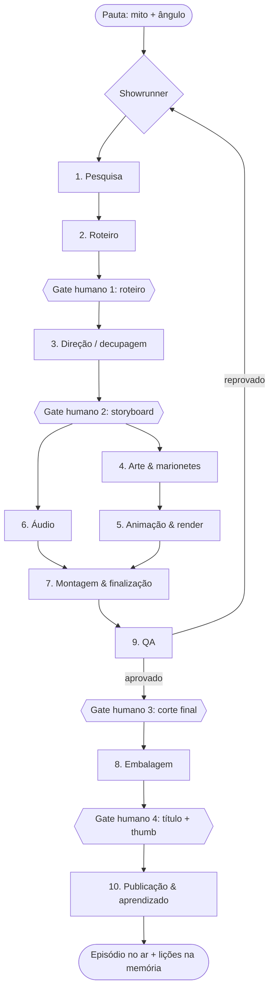

# 05 — Arquitetura de agentes (LangGraph)

> **O que este doc define:** todos os agentes necessários para sair de *"tema: A Odisseia"* e chegar a um episódio de ~24 min publicado, no padrão dos docs 03 (identidade) e 04 (cinematografia).
> **O que não define:** código. Aqui ficam o desenho, os contratos de dados e as regras de orquestração. A implementação e a operação com Antigravity estão no doc 06.
> **Fichas individuais:** cada agente tem uma ficha detalhada em [`agentes/`](./agentes/README.md).
> **Versão-alvo:** LangGraph 1.x (Python). Nomes de modelos ficam como **categorias**. Confira os modelos disponíveis na data da implementação.

---

## 1. Visão geral: um estúdio em forma de grafo

O grafo imita um estúdio de animação. Um **Showrunner** (supervisor) coordena **10 departamentos**, e cada um é um **subgrafo** com estado próprio. Os departamentos se comunicam só pelo **estado do episódio**, nunca diretamente.

**Paralelismo:** Arte e Áudio rodam ao mesmo tempo depois do storyboard. Dentro de Arte, Animação e Áudio, o trabalho é dividido **por plano** com a API `Send` (map-reduce). Um episódio tem ~200 planos.

---

## 2. Estado do episódio (o "contrato" entre agentes)

Um único objeto de estado, versionado pelo checkpointer. Cada departamento lê o que precisa e escreve **só no seu campo**.

| Campo | Dono (quem escreve) | Conteúdo |
|---|---|---|
| `episodio` | Showrunner | id, mito, ângulo, duração-alvo, idioma, status |
| `pesquisa` | Pesquisa | fontes (com canto/verso), fatos verificados, nomes canônicos, controvérsias |
| `roteiro` | Roteiro | blocos com texto do Contador, marcações [CENA], fontes por bloco, versões |
| `decupagem` | Direção | cenas → planos (ver contrato do plano, seção 5) |
| `color_script` | Direção (DoP) | nível de fogo por cena, proporção de tela, textura da parede |
| `elenco` | Arte | marionetes usadas (id na biblioteca), novas a criar |
| `assets` | Arte / Animação | caminhos de arquivos por plano: cenário, marionetes, render, status |
| `audio` | Áudio | narração por bloco, SFX, trilha, mix, LUFS medido |
| `timeline` | Montagem | linha do tempo (formato OTIO/EDL), versão do corte |
| `master` | Montagem | arquivo final, legendas, capítulos |
| `embalagem` | Embalagem | 3 títulos, 3 thumbs, descrição, tags, capítulos, Shorts |
| `qa` | QA | relatórios por verificação, itens bloqueantes |
| `aprovacoes` | Gates humanos | quem aprovou, quando, comentários (é a **evidência de contribuição humana**) |
| `custos` | Todos (append) | tokens, segundos de GPU e chamadas de API por nó |
| `erros` | Todos (append) | falhas, tentativas e decisão tomada |

**Regras de estado:**
- Campos de lista (`custos`, `erros`, `qa`) usam **reducer de append**: nunca sobrescrever.
- Arquivos pesados **não** ficam no estado. O estado guarda só o **caminho + hash** (storage de objetos).
- Toda escrita grava `versao` + `autor_no` para dar para auditar qual agente mudou o quê.

---

## 3. Os agentes, departamento por departamento

Legenda de tipo de modelo: **LLM-R** = LLM de raciocínio/escrita · **LLM-V** = LLM multimodal com visão · **IMG** = geração de imagem · **TTS** = voz · **Ferr.** = ferramenta determinística (sem LLM).

### 1 · Pesquisa (subgrafo)

| Agente | Função | Entrada → Saída | Ferramentas | Tipo |
|---|---|---|---|---|
| **Pesquisador de fontes** | Levanta o texto original e traduções de domínio público, organiza por canto/verso | mito → `pesquisa.fontes` | busca web, Perseus Digital Library, Wikisource, leitor de PDF | LLM-R |
| **Verificador de fatos** | Confirma cada fato em 2 fontes ou mais; marca o que é tradição tardia ou variante | fontes → `pesquisa.fatos` | mesmas + comparação | LLM-R |
| **Analista de referência** | Roda o método do doc 02 em vídeos concorrentes (cortes, ritmo, cor por cena) | URLs → métricas de ritmo e lacunas | ffmpeg (detecção de cena), folhas de contato, LLM-V | Ferr. + LLM-V |
| **Analista de demanda** | Busca, sugestões e concorrência no YouTube; define o ângulo do título | tema → ângulos ranqueados | YouTube Data API (search), Trends | LLM-R |

### 2 · Roteiro (subgrafo com ciclo crítico ↔ revisor)

| Agente | Função | Entrada → Saída | Tipo |
|---|---|---|---|
| **Arquiteto de estrutura** | Monta os 4 atos e as viradas do doc 04 §6.3, com tempos-alvo | fatos + ângulo → esqueleto | LLM-R |
| **Roteirista (voz do Contador)** | Escreve o texto narrado no tom do doc 03 §11, com marcações [CENA] | esqueleto → `roteiro` v1 | LLM-R |
| **Editor de retenção** | Avalia o gancho (≤ 45 s), os open loops a cada ~90 s e a ausência de "barriga" | roteiro → notas | LLM-R |
| **Revisor de fidelidade** | Cruza cada frase com `pesquisa.fatos`; bloqueia invenções | roteiro → notas bloqueantes | LLM-R |
| **Revisor de tom** | Corta clichês, gírias e frases de "canal de curiosidades"; mede palavras/min | roteiro → notas | LLM-R |

**Ciclo:** Roteirista → (Retenção ‖ Fidelidade ‖ Tom, em paralelo) → Roteirista revisa. **Máximo de 3 voltas**; se continuar reprovado, vai ao gate humano com as notas pendentes.

### 3 · Direção (subgrafo)

| Agente | Função | Saída | Tipo |
|---|---|---|---|
| **Diretor (decupagem)** | Quebra cada bloco em planos com a gramática do doc 04 §3 (tipo de plano, movimento, duração) | `decupagem` | LLM-R |
| **Diretor de fotografia** | Atribui nível de fogo (1–5), proporção de tela e luz de deus por cena, seguindo o color script | `color_script` | LLM-R |
| **Supervisor de direção de tela** | Valida → casa / ← contra em cada plano (doc 04 §4) | correções | LLM-R (regras) |
| **Diretor de arte** | Lista as marionetes e cenários necessários; consulta a biblioteca e marca o que é novo | `elenco` | LLM-R + Store |
| **Storyboarder** | Gera um quadro rápido por plano (imagem de baixa resolução) para o gate 2 | animatic | IMG + Ferr. (ffmpeg) |

### 4 · Arte & marionetes (subgrafo, `Send` por item novo)

| Agente | Função | Saída | Tipo |
|---|---|---|---|
| **Designer de silhuetas** | Cria marionetes novas no estilo figura negra, a partir da ficha do doc 03 §6.2 | PNG de alta resolução | IMG + LLM-V (auto-checagem) |
| **Vetorizador** | Converte em vetor limpo (sem cinza: preto absoluto + furos) | SVG | Ferr. (potrace) |
| **Rigger** | Separa as partes e define pivôs/pinos (ombro, cotovelo, quadril, joelho) | rig da marionete | LLM-V + Ferr. |
| **Cenógrafo** | Paredes, texturas e mapa de pergaminho por cena | texturas | IMG + Ferr. |
| **Bibliotecário** | Registra tudo na **Store** (memória de longo prazo) com tags; reaproveita entre episódios | índice de assets | Ferr. + Store |

### 5 · Animação & render (subgrafo, `Send` por plano)

| Agente | Função | Saída | Tipo |
|---|---|---|---|
| **Animador de plano** | Converte o plano (contrato §5) em parâmetros de cena: posição das marionetes, distância do fogo, curva do fogo, movimento de câmera, poses-chave | arquivo de cena parametrizado | LLM-R + Ferr. |
| **Montador de cena 3D** | Aplica os parâmetros num template Blender (luz-fogueira, parede, névoa, câmera) | `.blend` do plano | Ferr. (Blender headless) |
| **Gerente de render** | Envia para a fila de GPU, acompanha, reenvia se falhar | frames/vídeo do plano | Ferr. |
| **Engenheiro de prompt de vídeo** [adicionado na construção] | Converte planos do Contador, VFX e inserts em prompts cinemáticos refinados com bíblia, restrições e âncora visual | `assets.planos[<id>].video_ia` | Ferr. + LLM-R |
| **Revisor de plano** | Olha 3 quadros do render e compara com o storyboard e com a ficha da silhueta | aprovado / refazer + motivo | LLM-V |
| **VFX** | Brasas, fumaça e cinzas em primeiro plano; plano do Contador | camadas | Ferr. (templates) |

**Loop por plano:** Animador → Montador → Render → Revisor. Até **2 refações automáticas** por plano; na terceira falha, o plano vai para uma fila humana sem travar os outros 199.

### 6 · Áudio (subgrafo, roda em paralelo com Arte)

| Agente | Função | Saída | Tipo |
|---|---|---|---|
| **Diretor de voz** | Marca pausas, ênfases e andamento (140/165 ppm) no roteiro | roteiro anotado | LLM-R |
| **Narrador** | Gera a narração por bloco (voz própria clonada **ou** importa a gravação de um locutor humano) | WAV por bloco | TTS / Ferr. |
| **Sound designer** | Escolhe SFX por plano (fogo, foley de teatro, monstros) na biblioteca licenciada | lista + arquivos | LLM-R + Ferr. |
| **Supervisor musical** | Monta a trilha com leitmotivs (doc 04 §7) a partir de biblioteca licenciada | stems | LLM-R + Ferr. |
| **Mixador** | Ducking, silêncios dramáticos e loudness −14 LUFS | mix final | Ferr. (ffmpeg loudnorm) |

### 7 · Montagem & finalização (subgrafo)

| Agente | Função | Saída | Tipo |
|---|---|---|---|
| **Editor** | Monta a timeline: alinha planos à narração, aplica o ritmo do doc 04 §6, cortes J/L e match cuts | `timeline` | LLM-R + Ferr. (OTIO) |
| **Grafismo** | Insere cartelas de capítulo, lower thirds, mapa, contador de perdas e selos de fonte | camadas de motion | Ferr. (templates Remotion/AE) |
| **Finalizador** | Grão, halation, vinheta, letterbox, master 4K | `master` | Ferr. (ffmpeg / Resolve via script) |
| **Legendador** | SRT em PT-BR (+ ES/EN opcional), quebra de 38 caracteres | legendas | TTS-ASR + LLM-R |

### 8 · Embalagem (subgrafo)

| Agente | Função | Saída | Tipo |
|---|---|---|---|
| **Titulista** | 3 títulos testáveis (≤ 60 caracteres), sem repetir o texto da thumb | títulos | LLM-R |
| **Designer de thumbnail** | 3 thumbs (layouts A, B, C do doc 03 §8) a partir dos renders reais | PNGs | IMG + Ferr. (composição) |
| **Avaliador de feed** | Simula o feed do celular e mede legibilidade a 120 px | ranking | LLM-V |
| **Redator de metadados** | Descrição, capítulos (= cartelas), fontes citadas, tags | metadados | LLM-R |
| **Cortador de Shorts** | Escolhe 3–5 trechos de 30–50 s e reenquadra em 9:16 | Shorts | LLM-R + Ferr. |

### 9 · QA (subgrafo, checagens em paralelo)

| Agente | O que verifica | Bloqueia? |
|---|---|---|
| **QA técnico** | Resolução, fps, quadros pretos, frames congelados, loudness, sincronia | Sim |
| **QA de continuidade** | Silhuetas iguais às fichas, direção de tela, nível de fogo × color script | Sim |
| **QA de fidelidade** | Narração final (transcrita) × `pesquisa.fatos` | Sim |
| **QA de marca** | Paleta (≤ 5 cores, Brasa ≤ 5%), fontes, marca d'água, end screen | Não (aviso) |
| **QA de direitos** | Toda música, SFX e textura com licença registrada no estado | Sim |
| **QA de originalidade** | Similaridade com episódios anteriores (estrutura, planos reaproveitados, roteiro) e presença de registros nos gates humanos | Sim |

Se algum bloqueante falhar, o QA devolve um `Command(goto=…)` **para o departamento exato**, com o motivo, em vez de reiniciar o grafo.

### 10 · Publicação & aprendizado

| Agente | Função | Tipo |
|---|---|---|
| **Publicador** | Upload como **privado**, legendas, capítulos, thumb, agendamento | Ferr. (YouTube Data API) |
| **Analista de desempenho** | Lê retenção, CTR e origem de tráfego em 48 h e 7 dias | Ferr. (YouTube Analytics API) + LLM-R |
| **Curador de memória** | Grava lições na Store (ex.: "queda de retenção em 6:10 = plano parado demais") para os próximos episódios | LLM-R + Store |

**Total: 47 agentes + o Showrunner** (4 + 5 + 5 + 5 + 5 + 5 + 4 + 5 + 6 + 3). Cerca de 2/3 usam LLM; o resto são ferramentas determinísticas embrulhadas como nós.

---

## 4. Showrunner (supervisor)

| Responsabilidade | Como |
|---|---|
| Roteamento | Decide o próximo departamento pelo `episodio.status` + resultados do QA |
| Orçamento | Para o grafo se `custos` passar do teto do episódio |
| Prazos | Prioriza planos críticos (gancho, viradas) na fila de render |
| Escalada | Abre um item na fila humana quando um loop esgota as tentativas |
| Memória | Antes de começar, lê na Store as lições dos episódios anteriores e as injeta nos prompts dos departamentos |

O Showrunner **não cria conteúdo**: só decide. Isso evita que um agente "faça tudo" e perca o padrão.

---

## 5. Contrato do plano (a unidade de trabalho)

Cada um dos ~200 planos é um objeto com estes campos, e é ele que viaja pelo `Send`:

| Campo | Exemplo | Origem |
|---|---|---|
| `id` | `ep01_c07_p03` | Direção |
| `bloco_roteiro` | 7 | Roteiro |
| `mundo` | `parede` / `contador` | Direção |
| `tipo_plano` | `escala` | Direção (doc 04 §3.1) |
| `duracao_s` | 5,0 | Direção / Editor |
| `marionetes[]` | `{id: polifemo_v1, distancia_fogo: 0.2, direcao: "esq", pose_ini, pose_fim}` | Direção + Arte |
| `camera` | `{movimento: "tilt_up", lente_mm: 35, inicio, fim}` | Direção |
| `fogo` | `{nivel: 3, curva: "subida", tremulacao_hz: 2}` | DoP |
| `luz_deus` | `null` / `{tipo: "caustica_poseidon", lado: "baixo"}` | DoP |
| `proporcao` | `2.39` | DoP |
| `parede` | `caverna_umida` | Cenógrafo |
| `transicao_saida` | `match_cut:olho→fogueira` | Editor |
| `sfx[]` | `ronco_grave` | Sound designer |
| `storyboard` | caminho do quadro | Storyboarder |
| `intencao_visual` [adicionado na construção] | "O Contador estende a mão para o fogo..." | Direção |
| `render` | `{caminho, hash, status, tentativas}` | Animação |
| `qa` | `{continuidade: ok, notas}` | Revisor de plano |

**Hash do plano:** é calculado sobre os campos visuais. Se nada mudou, **o render não é refeito** (cache). Isso deixa as revisões baratas.

---

## 6. Padrões LangGraph usados

| Padrão | Onde | Por quê |
|---|---|---|
| **Supervisor + subgrafos** | Showrunner + 10 departamentos | Cada departamento é testável e substituível sozinho |
| **Map-reduce com `Send`** | Arte (por marionete), Animação e Áudio (por plano/bloco), QA (por checagem) | 200 planos em paralelo, com limite de concorrência |
| **Ciclo crítico ↔ autor** | Roteiro, Revisor de plano, Avaliador de feed | Qualidade sem humano a cada passo; limite de voltas evita loop infinito |
| **`interrupt` (human-in-the-loop)** | 4 gates (seção 7) | Pausa durável: o grafo espera horas ou dias sem ocupar recurso |
| **`Command(goto=…)`** | QA → departamento | Retrabalho cirúrgico |
| **Checkpointer em Postgres** | Todo o grafo | Retomar de qualquer ponto; histórico de versões; *time travel* para comparar cortes |
| **Store (memória longa)** | Bibliotecário, Curador de memória, Showrunner | Biblioteca de marionetes, fichas, lições entre episódios |
| **Retry policy por nó** | Chamadas de API, render | Falhas de rede/GPU não derrubam o episódio |
| **Jobs longos fora do grafo** | Render e TTS | O nó dispara o job e encerra; um webhook retoma o grafo (`resume`). O worker não fica preso esperando. |
| **Nós idempotentes** | Todo nó com efeito colateral | Ao retomar depois de um `interrupt`, o nó roda de novo desde o início, então ele não pode, por exemplo, subir o vídeo duas vezes |

---

## 7. Gates humanos (obrigatórios)

| Gate | Momento | O que o humano vê | Ações |
|---|---|---|---|
| **1 · Roteiro** | Depois do ciclo do Roteiro | Texto + notas dos revisores + fontes | aprovar / editar / pedir nova versão com comentário |
| **2 · Storyboard** | Depois da Direção | Animatic com narração provisória | aprovar / trocar planos / mudar o color script |
| **3 · Corte final** | Depois do QA | Master com marcações de QA | aprovar / lista de ajustes por timecode |
| **4 · Embalagem** | Antes de publicar | 3 títulos × 3 thumbs no mock do feed | escolher / editar |
| *(opcional)* **5 · Publicação** | Antes de sair do privado | Vídeo já no Studio, verificações do YouTube | publicar / agendar |

Cada decisão fica gravada em `aprovacoes` (quem, quando, o que mudou). É o registro técnico de que existe **direção criativa humana em cada episódio**.

---

## 8. Observabilidade e custo

| Métrica | Granularidade | Ferramenta |
|---|---|---|
| Trace de cada nó (prompt, resposta, latência) | Nó | LangSmith (ou equivalente OpenTelemetry) |
| Custo (tokens, s de GPU, chamadas) | Nó → departamento → episódio | `custos` no estado + dashboard |
| Taxa de refação | Plano / agente | Indica qual prompt ou template precisa melhorar |
| Tempo parado em gate | Gate | Mede o gargalo humano |
| Retenção × tipo de plano | Episódio publicado | Analista de desempenho → Store |

---

## 9. Ordem de construção recomendada

1. **Contratos primeiro:** estado do episódio + contrato do plano (seções 2 e 5).
2. **Esqueleto do grafo** com todos os nós retornando dados falsos (o fluxo completo roda de ponta a ponta).
3. **Pesquisa + Roteiro + Gate 1** (o primeiro valor real).
4. **Direção + Storyboard + Gate 2.**
5. **Template Blender + Animação de 1 plano**, depois por `Send` com 10 planos.
6. **Áudio** (paralelo ao item 5).
7. **Montagem + QA técnico.**
8. **Embalagem + Publicação** em modo privado.
9. **Memória/aprendizado** depois de 3 episódios publicados.
