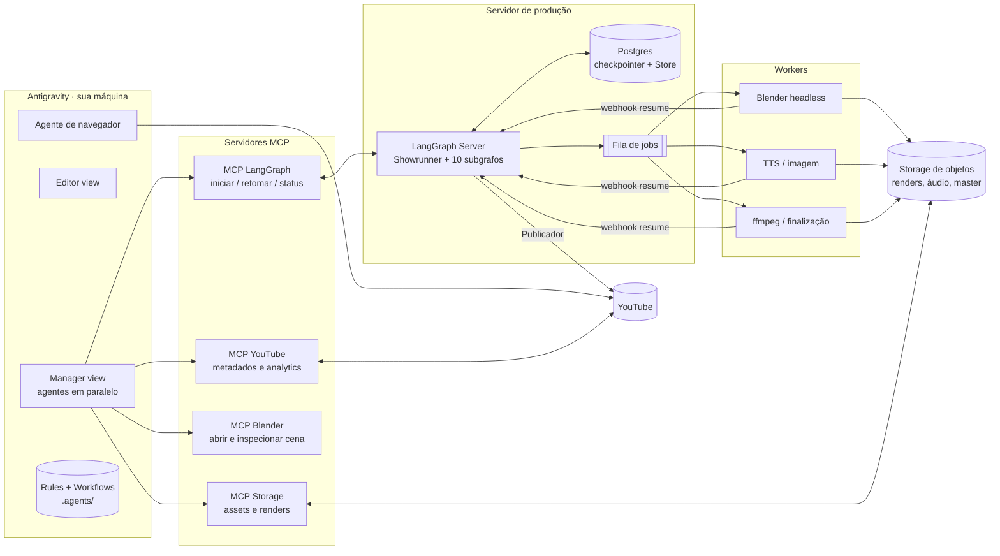
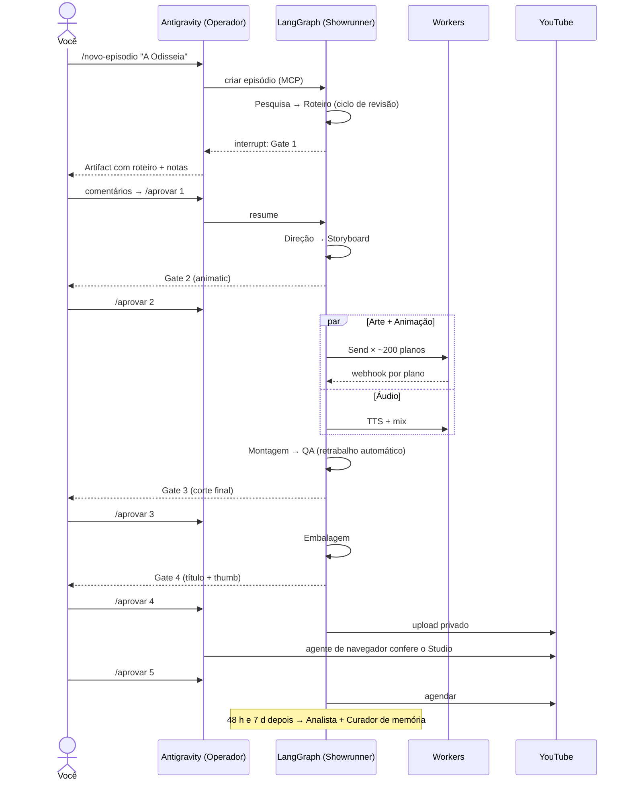

# 06 — Automação completa: LangGraph + Antigravity

> **Doc anterior:** o 05 define *quais* agentes produzem o episódio (runtime em LangGraph).
> **Este doc define:** como **construir, operar e manter** esse estúdio automaticamente usando o **Google Antigravity** (IDE agent-first), e como os dois se conectam.
> **Atenção à versão:** os recursos do Antigravity citados aqui (Manager view, Artifacts, Rules, Workflows, MCP, agente de navegador) estão descritos como existiam na pesquisa feita para este doc. Confira na versão instalada antes de implementar.

---

## 1. Quem faz o quê

| | **LangGraph** | **Antigravity** |
|---|---|---|
| Papel | **Motor de produção**: roda o episódio | **Estúdio de engenharia e sala de controle** |
| Quando roda | Em servidor, 24/7, sem IDE aberta | Quando você (ou um agente seu) está construindo, operando ou revisando |
| Agentes | Os 47 agentes + Showrunner do doc 05 (runtime) | Agentes de desenvolvimento e operação (seção 3) |
| Estado | Checkpointer Postgres + Store | Workspace (repositório), Artifacts, base de conhecimento |
| Humano | Responde aos 4 gates (`interrupt`) | Revisa planos, artifacts e diffs; dispara workflows |

**Resumindo:** o Antigravity **constrói e pilota** o LangGraph. O LangGraph **fabrica** o vídeo.

---

## 2. Arquitetura de implantação

**Pontos-chave:**
- O Antigravity **nunca** chama modelos de render diretamente. Ele fala com o LangGraph pelo MCP. Assim, toda produção passa pelo grafo e fica registrada no checkpointer.
- Os workers de GPU são **sem estado**: recebem um plano (contrato do doc 05 §5), renderizam, gravam no storage e chamam o webhook que retoma o grafo.
- O YouTube recebe uploads **só pelo Publicador** (API oficial). O agente de navegador do Antigravity só **lê e confere** o Studio, não publica.

---

## 3. Agentes do Antigravity (desenvolvimento e operação)

Rodam na **Manager view**, cada um no seu workspace ou branch, em paralelo, entregando **Artifacts** (plano de implementação, lista de tarefas, walkthrough, capturas, gravações do navegador) para você revisar e comentar.

| Agente | Missão | Entrega típica (Artifact) |
|---|---|---|
| **Arquiteto do pipeline** | Mantém os contratos (estado, plano) e o desenho do grafo em sincronia com os docs 03–05 | Plano de implementação + diagrama atualizado |
| **Engenheiro de grafo** | Implementa e altera nós, subgrafos, `Send`, `interrupt` e retries | Diff + walkthrough + testes passando |
| **Engenheiro de prompts** | Escreve e versiona os prompts de todos os agentes com LLM, com casos de teste (ex.: "roteiro com gíria deve ser reprovado") | Tabela antes/depois com o resultado dos testes |
| **Técnico de Blender** | Mantém o template de cena (luz-fogueira, parede, névoa, câmera, rig das marionetes) | Capturas de 3 renders de teste |
| **Engenheiro de motion** | Templates de cartela, lower third, mapa com rota queimando, contador de perdas e end screen | Gravação de preview |
| **QA do pipeline** | Roda o "episódio de fumaça" (5 planos, 60 s) a cada mudança e compara com a referência | Relatório + vídeo de 60 s |
| **Operador** | Executa os workflows de produção (seção 5) e acompanha o grafo pelo MCP | Status do episódio, itens na fila humana |
| **Agente de navegador** | Confere o YouTube Studio (verificações de direitos, processamento, HD), testa thumbs num mock de feed e lê comentários | Gravação do navegador + capturas |

> **Separação importante:** os agentes do Antigravity **mudam o sistema**. Os agentes do LangGraph **usam o sistema**. Um agente do Antigravity nunca edita um episódio "na mão" fora do grafo.

---

## 4. Rules (o que todo agente do Antigravity precisa obedecer)

Rules são arquivos Markdown carregados automaticamente. Ficam no repositório em `.agents/rules/`, mais um `AGENTS.md` na raiz.

| Arquivo de rule | Ativação | Conteúdo |
|---|---|---|
| `AGENTS.md` (raiz) | sempre | Visão do projeto, links para os docs 03–06, "nunca publicar sem os gates", estrutura de pastas |
| `identidade-lume.md` | sempre | Resumo do doc 03: paleta de 5 cores com proporções, 2 fontes, regras de silhueta, do/don't |
| `cinematografia.md` | glob: `blender/**`, `motion/**`, `grafo/direcao/**` | Resumo do doc 04: níveis de fogo, direção de tela, proporção de tela, ritmo |
| `contratos.md` | glob: `grafo/**` | Estado e contrato do plano são a fonte da verdade; mudar um campo exige atualizar o doc 05 |
| `langgraph-convencoes.md` | glob: `grafo/**` | Nós idempotentes, efeitos colaterais depois do `interrupt`, sem arquivos pesados no estado, retry obrigatório em chamadas externas |
| `prompts.md` | glob: `prompts/**` | Todo prompt tem versão, casos de teste e critério de reprovação |
| `seguranca.md` | sempre | Segredos só em variáveis de ambiente; nunca em código, prompt ou Artifact; o agente de navegador não usa conta com permissão de dono |
| `originalidade.md` | por decisão do modelo | Checklist técnico: nada de reaproveitar planos sem mudança, os gates registram decisão humana, toda licença fica registrada |

Rules globais pessoais (por exemplo, "responda em português") ficam no arquivo global do usuário, fora do repositório.

---

## 5. Workflows (comandos de produção)

Workflows são sequências salvas em Markdown e chamadas com `/nome` no chat do agente. Um workflow pode chamar outro.

| Workflow | Passos | Resultado |
|---|---|---|
| **`/novo-episodio`** | 1. Pergunta o mito e o ângulo · 2. Cria o `episodio` via MCP LangGraph · 3. Acompanha Pesquisa e Roteiro · 4. Para no **Gate 1** e mostra o roteiro como Artifact | Episódio criado, roteiro pronto para revisão |
| **`/aprovar <gate>`** | 1. Lê seus comentários no Artifact · 2. Converte em `resume` estruturado (aprovar / editar / refazer) · 3. Retoma o grafo | Grafo segue para o próximo departamento |
| **`/status`** | Lê o checkpoint atual: departamento, planos prontos/na fila/falhos, custo acumulado | Painel em texto + lista da fila humana |
| **`/revisar-plano <id>`** | Mostra storyboard × render × ficha da silhueta lado a lado e aceita ajustes de parâmetros | Plano refeito (com cache de hash) |
| **`/rerender <filtro>`** | Ex.: "todos os planos com Polifemo" depois de mudar a marionete | Só os afetados são refeitos |
| **`/corte-final`** | Monta, finaliza, roda o QA e para no **Gate 3** | Master + relatório de QA |
| **`/embalar`** | Gera títulos, thumbs e Shorts e para no **Gate 4** com o mock do feed | Pacote de publicação |
| **`/publicar`** | Upload privado → o agente de navegador confere o Studio → **Gate 5** → agenda | Episódio agendado |
| **`/pos-mortem <ep>`** | 7 dias depois: lê analytics, cruza retenção × planos e grava lições na Store | Lições aplicadas no próximo episódio |
| **`/novo-personagem`** | Ficha de silhueta → Designer → Vetorizador → Rigger → biblioteca | Marionete nova pronta para uso |
| **`/fumaca`** | Episódio de teste de 60 s depois de qualquer mudança no sistema | Passou / falhou, com o vídeo |

---

## 6. Fluxo ponta a ponta (um episódio)

**Seu tempo por episódio:** só os 5 gates. Todo o resto é automático, incluindo o retrabalho do QA.

---

## 7. Estrutura do repositório (pastas, sem código)

| Pasta | Conteúdo | Quem mantém |
|---|---|---|
| `docs/` | Docs 00–06 (fonte da verdade criativa) | Você |
| `.agents/rules/` | Rules da seção 4 | Arquiteto do pipeline |
| `.agents/workflows/` | Workflows da seção 5 | Operador / Arquiteto |
| `grafo/` | Showrunner + uma subpasta por departamento | Engenheiro de grafo |
| `contratos/` | Esquemas do estado e do plano | Arquiteto do pipeline |
| `prompts/` | Um arquivo por agente LLM + casos de teste | Engenheiro de prompts |
| `blender/` | Template de cena, rigs, scripts de montagem | Técnico de Blender |
| `motion/` | Templates de grafismo | Engenheiro de motion |
| `biblioteca/` | Índice da biblioteca de marionetes e texturas (os arquivos ficam no storage) | Bibliotecário (runtime) |
| `mcp/` | Configuração dos servidores MCP da seção 2 | Arquiteto do pipeline |
| `testes/` | Episódio de fumaça, casos de prompt, testes de contrato | QA do pipeline |

---

## 8. Níveis de automação (roadmap)

| Fase | O que é automático | O que é humano | Critério para avançar |
|---|---|---|---|
| **0 · Manual assistido** | Pesquisa e rascunho de roteiro | Todo o resto | Roteiro aprovado sem reescrita grande |
| **1 · Pré-produção** | Roteiro + decupagem + storyboard | Arte, animação, montagem | Animatic aprovado com < 10% dos planos trocados |
| **2 · Produção** | + marionetes, render por plano, áudio | Montagem fina, embalagem | < 15% de refação manual de planos |
| **3 · Estúdio** | Tudo, até o master e a embalagem | Os 5 gates | 3 episódios seguidos sem retrabalho fora dos gates |
| **4 · Escala** | + Shorts, legendas em ES/EN, pós-mortem | Os 5 gates | — |

**Não existe fase "sem humano".** Os gates ficam para sempre: são o controle de qualidade e o registro de direção criativa que diferencia o canal de produção em massa.

---

## 9. Segurança e permissões

| Risco | Medida |
|---|---|
| Agente rodando comando destrutivo | Terminal do Antigravity em modo que **pede confirmação** para comandos fora de uma lista permitida |
| Ferramentas MCP sem revisão | Ferramentas novas ficam em modo "perguntar" até serem aprovadas explicitamente |
| Segredos (chaves de API, OAuth do YouTube) | Só em variáveis de ambiente do servidor; nunca no repositório, nos prompts, no estado ou em Artifacts |
| Conta do YouTube | O Publicador usa OAuth com escopo de upload; o agente de navegador usa um usuário com permissão de **gerente** (não proprietário) |
| Custo descontrolado | Teto por episódio no Showrunner + alerta por departamento |
| Publicação acidental | Upload sempre privado; só o Gate 5 muda a visibilidade |

---

## 10. Riscos técnicos e mitigação

| Risco | Mitigação |
|---|---|
| Silhueta gerada por IA sai inconsistente | Marionetes são criadas **uma vez**, vetorizadas e rigadas; a IA nunca redesenha o personagem por plano |
| Render de 200 planos demora | `Send` com limite de concorrência + cache por hash + prioridade para gancho e viradas |
| Retomada depois de `interrupt` duplica efeito (upload duplo, cobrança dupla) | Nós idempotentes com chave de operação gravada no estado |
| Prompt melhora um agente e piora outro | Casos de teste por agente + `/fumaca` obrigatório em cada mudança |
| Mudança de API ou modelo | Modelos referenciados por **categoria** em configuração, não fixos no código |
| Contratos divergem dos docs | Rule `contratos.md` + Arquiteto do pipeline revisando cada PR |

---

## 11. Checklist para começar

- [ ] Instalar o Antigravity e criar o workspace com a pasta `docs/` atual
- [ ] Escrever `AGENTS.md` + as 8 rules da seção 4 (resumos dos docs 03–05)
- [ ] Subir Postgres (checkpointer + Store) e o storage de objetos
- [ ] Pedir ao **Arquiteto do pipeline** (Manager view) o plano de implementação da Fase 0 e revisar o Artifact
- [ ] Configurar o MCP LangGraph (criar, retomar e ver status do episódio)
- [ ] Criar os workflows `/novo-episodio`, `/aprovar` e `/status`
- [ ] Rodar o EP01 *A Odisseia* na Fase 0 e medir onde está o gargalo
